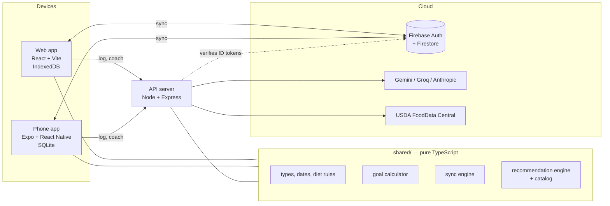
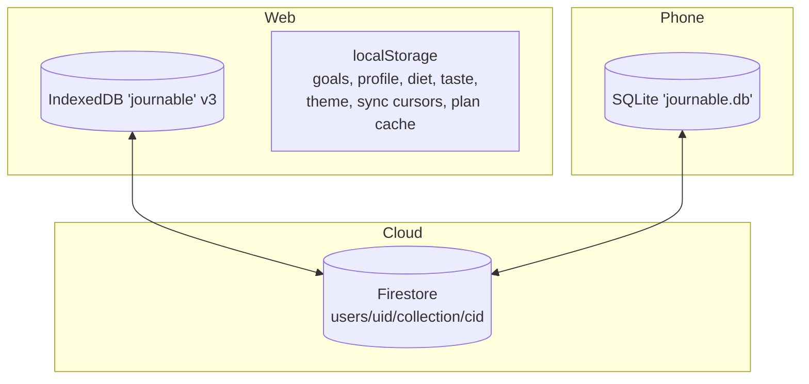
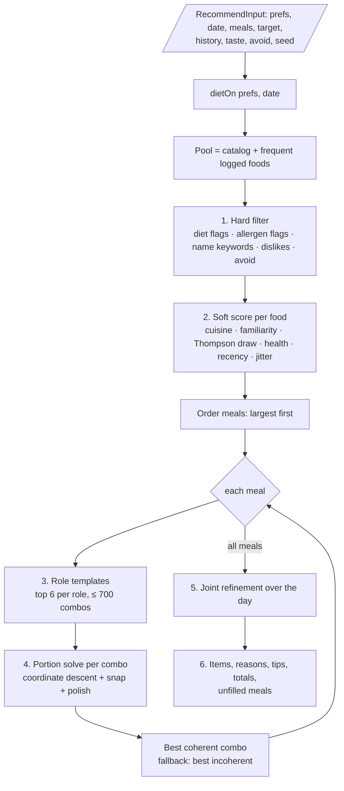

# Architecture

How Journable is built: the pieces, the data, the algorithms, and the evidence that they work. Written for an engineer who is new to the codebase.

Related documents: [DECISIONS.md](DECISIONS.md) (why each choice was made), [FLOW.md](FLOW.md) (user and data flows), [SETUP-FIREBASE.md](SETUP-FIREBASE.md) (turning on sign-in and sync), [README.md](README.md) (quick start).

## Contents

1. [Purpose, constraints and non-goals](#1-purpose-constraints-and-non-goals)
2. [System at a glance](#2-system-at-a-glance)
3. [Repository layout](#3-repository-layout)
4. [Runtime components](#4-runtime-components)
5. [Data architecture](#5-data-architecture)
6. [The recommendation engine](#6-the-recommendation-engine)
7. [The sync system](#7-the-sync-system)
8. [The AI subsystem](#8-the-ai-subsystem)
9. [Security and privacy](#9-security-and-privacy)
10. [Quality: tests, benchmarks, and what is not verified](#10-quality-tests-benchmarks-and-what-is-not-verified)
11. [Performance and cost](#11-performance-and-cost)
12. [References](#12-references)
13. [Roadmap](#13-roadmap)
14. [Glossary](#14-glossary)

---

## 1. Purpose, constraints and non-goals

**Purpose.** A personal food and weight tracker that is pleasant to use, understands what you say you ate (any language, or a photo), plans meals that fit your goals and your diet, and keeps your devices in sync.

**Design constraints.**

| Constraint | Consequence |
| --- | --- |
| One developer, no Android Studio, no Mac, Windows machine | Web first; phone through Expo Go and cloud builds; no native code written by hand |
| Free tiers only (Gemini, Firebase Spark, USDA) | Provider fallback, caching, an engine that makes no API calls at all |
| Personal data | Local-first; keys never on a client; sync is optional and private to the user |
| Must keep working when things fail | Timeouts, fallbacks, honest error messages, nothing blocks on the network |
| Diet and allergy rules must be reliable | Rules enforced by deterministic code, not by a language model |

**Non-goals (for now).** Medical advice; a social or multi-user product; a food database of record; iOS shipping; payments.

---

## 2. System at a glance



Three ideas organise the system:

1. **Each device is complete on its own.** It stores data, plans meals and shows charts with no network. The server and the cloud only add things (AI understanding, sync).
2. **Pure logic is written once** in `shared/` and used by the web app, the phone app and the server.
3. **The language model is a component, not the brain.** It understands free text and photos and converses. Rules, planning, syncing and learning are deterministic code.

---

## 3. Repository layout

```
Journable/
├─ src/                    Web app (React + TypeScript + Vite)
│  ├─ views/               Log (DayView), Plan, Coach, Calendar, Weight, Goals, Login
│  ├─ components/          Entry dialog, diet editor, account card, toast, icons, logo, theme switch
│  ├─ lib/                 firebase, session (auth + sync lifecycle), localSync, remote (Firestore), token
│  └─ db.ts                Dexie database, change tracking, settings, tombstones
├─ mobile/                 Phone app (Expo SDK 57, Expo Router)
│  └─ src/
│     ├─ app/              (tabs): Today, Plan, Coach, Weight, Goals;  entry/[id] edit sheet
│     ├─ components/       Ring, EntryRow (swipe), Composer, DietEditor, Account, LoginScreen, Toast, ui kit
│     └─ lib/              db (SQLite), api, coach tools, session, localSync, remote, image, haptics
├─ shared/                 Pure TypeScript used by all three runtimes
│  ├─ types.ts  dates.ts  nutrition.ts  diet.ts  sync.ts
│  └─ recommend/           catalog, engine, solver, taste, history, rules
├─ server/                 API (Node ESM, plain JavaScript)
│  ├─ index.mjs            routes, auth middleware
│  ├─ analyze.mjs          free text/photo → items (validate, repair, ground)
│  ├─ llm.mjs, llm.langchain.mjs   provider adapters, fallback chain
│  ├─ grounding.mjs        USDA matching
│  ├─ coach.mjs, coach.graph.mjs   classic coach, LangGraph coach
│  ├─ plan.mjs, planSchema.mjs     LLM meal planner (fallback / "AI suggestions")
│  ├─ auth.mjs             Firebase ID-token verification, allow-list, rate limit
│  └─ schema.mjs           Zod schemas, tolerant JSON extraction
├─ tests/                  Vitest suites (192 tests)
├─ eval/                   Benchmarks: recommend-eval.ts, run.mjs + dataset.json (logging)
├─ scripts/                Icon and asset generation
├─ firestore.rules         Per-user access rules
└─ DECISIONS.md  FLOW.md  Architecture.md  SETUP-FIREBASE.md  README.md
```

Size of the core (lines): shared logic ≈ 1,500 (engine 391, catalog 269, diet 295, sync 172), server ≈ 1,000.

---

## 4. Runtime components

### 4.1 Web app

React 18, TypeScript, Vite. Reads and writes IndexedDB through Dexie with `useLiveQuery`, so screens update automatically. Tabs: **Log** (calorie ring, macros, meals, swipe-less hover actions, drag between meals), **Plan**, **Coach**, **Calendar**, **Weight**, **Goals**. A sign-in gate appears only when Firebase variables are present. Theme (light, dark, system) and a `?theme=` preview parameter; tabs are addressable by `#plan`, `#coach` and so on.

### 4.2 Phone app

Expo SDK 57 (React Native 0.86, React 19.2) with Expo Router (file-based routes in `src/app`). SQLite for data, Reanimated for motion, Gesture Handler for swipe actions, Haptics for feedback, `react-native-svg` for the ring and charts. The edit sheet is a native form sheet route. The Google sign-in module is loaded lazily so Expo Go keeps working. Package id `com.mihir.journablelocal`.

### 4.3 API server

Express, plain JavaScript ESM, Node 22 (which also runs the TypeScript files in `shared/` directly).

| Route | Purpose | Auth |
| --- | --- | --- |
| `GET /api/health` | provider chain, layer, coach engine, whether auth is required | open |
| `POST /api/analyze` | free text or photo → items with calories and macros | when enabled |
| `POST /api/plan` | LLM meal planner (fallback and "AI suggestions") | when enabled |
| `POST /api/coach` | classic JSON-protocol coach step | when enabled |
| `POST /api/coach/chat`, `/resume` | LangGraph coach (pauses for client tools) | when enabled |

"When enabled" means `FIREBASE_PROJECT_ID` is set; otherwise the server is open, exactly as in local development. Environment variables: provider keys and models, `AI_PROVIDER`, `AI_FALLBACKS`, `LLM_LAYER`, `COACH_ENGINE`, `USDA_API_KEY`, `GROUNDING`, `FIREBASE_PROJECT_ID`, `ALLOWED_EMAILS`, `RATE_LIMIT_PER_MIN`.

### 4.4 Shared core

| Module | Responsibility |
| --- | --- |
| `types.ts` | `Entry`, `WeightEntry`, `Correction`, `Goals`, AI item types; optional sync fields (`cid`, `updatedAt`, `dirty`) |
| `dates.ts` | Date helpers, `MEALS`, `autoMeal()` (meal from the clock), `longDate` ("Sunday, October 18th") |
| `nutrition.ts` | `buildPlan`: BMR, TDEE, deficit or surplus by pace, safety floors, macro split, weeks to target |
| `diet.ts` | Diets, per-weekday rules (`dietOn`), allergen expansion, keyword safety net, cuisines and region detection, meal shares, "rest of day" helpers, plan API types |
| `sync.ts` | `syncOnce`, `createSyncManager`, last-write-wins `isNewer`, adapter interfaces |
| `recommend/*` | The recommendation engine (§6) |

---

## 5. Data architecture

### 5.1 Stores



**Web, IndexedDB (Dexie schema v3).**

| Table | Key and indexes | Notes |
| --- | --- | --- |
| `entries` | `++id, date, createdAt, cid` | one logged food or exercise |
| `weights` | `++id, date, cid` | `cid = w-YYYY-MM-DD`, one per day |
| `corrections` | `++id, key, createdAt, cid` | the user's edits, used as AI hints |
| `tombstones` | `key = collection:cid` | deletions awaiting upload |

Table hooks stamp `cid`, `updatedAt` and `dirty = 1` on every normal write. Writes made while applying cloud changes run in a transaction flagged `remote`, which skips the stamp, so they never bounce back. Small settings (goals, profile, diet, taste) live in `localStorage` with `settings:updatedAt:*` and `settings:dirty:*` markers.

**Phone, SQLite.** Tables `entries`, `weights`, `corrections` (each with `cid`, `updated_at`, `dirty`, `deleted`) and `settings (key, value, updated_at, dirty)`. Deletes are soft (`deleted = 1`) so they can be uploaded. A one-time migration adds the sync columns to existing databases and gives legacy rows an id and `dirty = 1`.

**Cloud, Firestore.** `users/{uid}/{collection}/{cid}` holding `{ cid, updatedAt, deleted, data, syncedAt }`, where `syncedAt` is a server timestamp that drives the pull cursor. Rules allow a signed-in user to read and write only their own subtree.

### 5.2 Sync records and what syncs

Collections: `entries`, `weights`, `corrections`, `settings`. The `settings` collection carries four documents keyed by name: `goals`, `profile`, `diet`, `taste`. Server-only or device-only values do not sync (server address, onboarding flags, theme, plan cache, sync cursors).

### 5.3 What leaves the device

| Data | Goes to | When |
| --- | --- | --- |
| Text you type and photos you attach | Your API server, then the AI provider | when you log (photo is resized and sent once, not stored) |
| Up to 5 matching corrections | same | with the log text, as hints |
| Tool results (your log summaries) | same | only what the coach asks for |
| Food names for lookups | USDA | grounding |
| Your records and settings | Firestore (your private area) | only when signed in |
| Meal plans from the recommendation engine | nowhere | computed on the device |

---

## 6. The recommendation engine

This section is the core technical contribution, so it is written in detail. Code: `shared/recommend/`. Tests: `tests/recommend.test.ts` (32). Benchmark: `eval/recommend-eval.ts`.

### 6.1 Problem statement

Given a person and a day, choose foods and portions for a set of meals so that:

- **Hard constraints** hold: the diet that applies on that weekday, allergies, dislikes, and an "avoid" list.
- **Targets** are met as closely as possible: calories, protein, carbohydrate and fat, for the meals being planned.
- **Soft goals** are served: cuisine preference, familiarity, learned taste, health, variety, and meals that read as one coherent cuisine.

Let `x_i` be the number of servings of food `i` (a decision variable), `a_ri` the amount of nutrient `r` in one serving of it, and `t_r` the target. We want to choose a small set of foods `S` (2 to 4 per meal, following a meal structure) and portions `x`, such that:

```
minimise   Σ_r  w_r · ((Σ_{i∈S} a_ri x_i − t_r) / s_r)²   +   Σ_{i∈S} λ_i (x_i − 1)²      (fit + portion pull)
subject to x_i ∈ [min_i, max_i]   and   x_i on a countable step grid,
           every i ∈ S satisfies the hard constraints,
with s_r = max(|t_r|, 1)   (so errors are relative)
```

and, among near-equal fits, prefer sets with higher preference scores. The first term is the continuous core of the classic *diet problem*; the set selection is combinatorial. The engine therefore separates the two: enumerate plausible food sets, solve the continuous portion problem exactly for each, and rank.

### 6.2 Where this sits in the literature

The food-recommendation literature groups approaches into content-based, collaborative, knowledge-based and hybrid, with growing attention to *health-awareness* and *context* (time of day, cuisine) [R5, R6, R20]. Collaborative and deep approaches need a large history of user–item interactions, which a single-user app does not have, so Journable follows the **knowledge-based + content-based hybrid** line, adds a small bandit for personalisation, and treats the nutrition targets as an optimisation problem in the tradition of diet-problem and menu-planning work [R1–R4].

| Design element in Journable | Idea it draws on | Reference |
| --- | --- | --- |
| Nutrient targets as a constrained optimisation over portions | The diet problem | R1 (Stigler 1945), R2 (Dantzig 1990, *not confirmed*) |
| Foods and portions as the decision, integer-valued in practice (snap to steps) | Mixed-integer menu planning | R3 (Sklan & Dariel 1993) |
| Portion bounds as "acceptability" limits so a plan is edible | LP for realistic diets | R4 (Briend et al. 2003) |
| Knowledge-based + content-based hybrid | Recommender taxonomy | R20 (Burke 2002), R19 (Lops et al.) |
| Health-awareness alongside preference; a mild nutrient-density bonus | Health-aware food recommendation; nutrient density | R9 (Ge et al. 2015), R17 (Drewnowski 2005) |
| Familiar foods weighted up so healthy plans are acceptable | Food-choice biases and healthier recommendation | R7 (Elsweiler et al. 2017) |
| Meals that read as one cuisine (ingredient compatibility, hand-built) | Ingredient networks | R10 (Teng et al. 2012) |
| Cuisine and time-of-day as context | Food recommender surveys | R5, R6 |
| Diversity: penalise repeats, avoid duplicates | Diversity re-ranking (MMR principle) | R11 (Carbonell & Goldstein 1998) |
| Learning likes and dislikes with exploration | Thompson sampling; contextual bandits | R12 (Chapelle & Li 2011), R13 (Li et al. 2010) |
| Fiber adequacy rule; macro ranges | Dietary Reference Intakes | R15 (IOM 2005; the specific figures were not confirmed here) |
| Notes on B12, iron, calcium, omega-3 for plant-based diets | Position paper on vegetarian diets | R16 (Melina et al. 2016) |
| Calorie targets from a person's profile | Predictive equation for resting energy expenditure | R14 (Mifflin et al. 1990) |

Where a paper only *inspired* a choice rather than being implemented literally, the table says so: the diversity rules are penalties inspired by the MMR principle rather than literal MMR; the health bonus is a heuristic, not the published Nutrient Rich Foods index; coherence is a hand-built rule rather than a learned ingredient network.

### 6.3 Pipeline



### 6.4 The knowledge base (catalog)

`shared/recommend/catalog.ts`, 146 foods. One typical serving each:

```ts
interface Food {
  id; name; cuisines: string[]        // ids, or '*' for "suits any cuisine"
  meals: ('breakfast'|'lunch'|'snack'|'dinner')[]
  role: 'main'|'carb'|'protein'|'veg'|'side'|'fruit'|'drink'|'snack'
  serving: { label; grams }
  kcal; protein; carbs; fat; fiber    // kcal is DERIVED: round(4P + 4C + 9F)
  contains: Ingredient[]              // meat, fish, shellfish, egg, dairy, honey, gelatin, root, allium, mushroom
  allergens: Allergen[]               // nuts, peanuts, dairy, eggs, gluten, soy, sesame, shellfish, fish
  tags: ('high-protein'|'whole-grain'|'legume'|'fried'|'sweet'|'indulgent'|'light'|'fermented')[]
  portion: { min; max; step }         // servings the solver may use, and the grid it snaps to
  keywords: string[]                  // extra words for matching dislikes
  source: 'catalog' | 'history'
}
```

**Diets are derived from ingredient classes**, not from names:

| Diet | Foods are excluded if they contain |
| --- | --- |
| Non-vegetarian | nothing |
| Pescatarian | meat, gelatin |
| Eggetarian | meat, fish, shellfish, gelatin |
| Vegetarian | meat, fish, shellfish, gelatin, egg |
| Vegan | the above, plus dairy and honey |
| Jain | meat, fish, shellfish, gelatin, egg, honey, root vegetables, allium (onion, garlic), mushroom |

Allergen categories are matched to the user's allergy terms through a small dictionary ("nuts" covers nuts and peanuts; "seafood" covers fish and shellfish; and so on). When unsure whether an ingredient is present, it is flagged (safe direction). Because calories are computed from macros, a food cannot contradict itself.

**History foods.** `buildHistory` summarises the last 120 days of logged food into median macros, a count, the most common meal and days since last eaten. Foods logged at least twice become extra candidates with a familiarity score `min(1, count/maxCount) · e^(−days/60)`. A logged food whose name matches a catalog food reuses the catalog entry (its familiarity still counts). History foods carry no ingredient flags, so they are checked by the keyword safety net only.

**Honest limits.** The numbers are representative, rounded figures good to roughly ±15% for a home-cooked portion, not lab data. Coverage is deepest for Indian food and thinner for other cuisines; the planner can fall back to the AI for a meal it cannot fill.

### 6.5 Hard constraints

`isAllowed(food, {diet, allergies, dislikes})` returns true only if: the diet's excluded ingredients are absent (flags), none of the user's allergen categories match the food's allergens (flags), no allergy or dislike term appears in the food's name or keywords (keyword net, conservative), and, for history foods, the diet keyword check passes. The "avoid" list (used by Swap) removes dishes by normalised name. Because these are filters applied before scoring, a forbidden food can never be selected, whatever its score.

### 6.6 Soft preferences

Each candidate gets a score once per plan:

```
score(f) =  cuisine(f)                        +0.25 if it matches a chosen cuisine, +0.10 if it suits any cuisine, −0.15 otherwise
          + 0.30 · familiarity(f)             from logged history, decays with e^(−days/60)
          + 0.60 · 2 · (θ_f − 0.5)            θ_f ~ Beta(a_f, b_f)  (Thompson draw; §6.9)
          + 0.10  if fiber ≥ 4 g or tagged whole-grain or legume
          − 0.15  if tagged indulgent or fried
          − 0.60 · e^(−d/2)                   if eaten d days ago (d ≤ 3): recency
          + u,   u ~ Uniform(−0.08, 0.08)     jitter, so "Plan again" differs
```

| Constant | Value | Role |
| --- | --- | --- |
| `fit` weights (kcal, protein, carbs, fat) | 3, 2, 1, 1 | calories matter most, protein next |
| `portionPull` | 0.004 | gentle pull toward one normal serving |
| `fitScale` | 100 | trades fit cost against preference when ranking combinations |
| `cuisineMatch` / `familiarity` / `taste` | 0.25 / 0.30 / 0.60 | preference weights |
| `healthBonus` / `healthPenalty` | 0.10 / 0.15 | small nudges, never overriding fit |
| `recent` | 0.60, half-life ≈ 1.4 days | strong enough to beat the familiarity bonus |
| `jitter` | ±0.08 | variety between plans |
| `incoherent` | 0.45 | extra cost when a meal mixes cuisines and no coherent option exists |
| `mealShare` row weight | 0.5 | per-meal calorie target during day refinement |
| Meal calorie shares | 25% breakfast, 35% lunch, 10% snack, 30% dinner | split a day's target; renormalised for partial days |

### 6.7 Meal structure and search

A meal is built from **roles**. Templates, in order of preference:

| Meal | Templates (roles) |
| --- | --- |
| Breakfast | main · main + fruit · main + drink · carb + protein · carb + protein + fruit |
| Lunch, Dinner | carb + protein + veg · main + veg · carb + protein + veg + side · main + side · main |
| Snack | snack · snack + fruit · fruit + drink · snack + drink |

For each template the engine takes the top **6** candidates per role by score and enumerates their Cartesian product, capped at **700** combinations per template, skipping combinations that repeat a food. A meal therefore evaluates at most a few thousand combinations; in the benchmark a full day averages about 2,200. Meals are filled largest first so the most constraining meals pick before the small ones. Within a plan, a non-staple food is used once; staples (`carb` role such as rice or roti) may repeat across meals with a small penalty.

### 6.8 Portion optimisation

For a fixed combination, the portion problem is a **convex quadratic program** with box constraints:

```
J(x) = Σ_r (w_r / s_r²) · (Σ_i a_ri x_i − t_r)²  +  Σ_i λ_i (x_i − p_i)²           x_i ∈ [min_i, max_i]
```

(`p_i` is the preferred portion, normally 1.) Cyclic **coordinate descent** minimises `J` exactly because each one-variable update has a closed form. Fixing every variable except `x_i`:

```
A_i = λ_i + Σ_r (w_r / s_r²) · a_ri²
B_i = −λ_i p_i + Σ_r (w_r / s_r²) · a_ri · ( Σ_{j≠i} a_rj x_j − t_r )
x_i ← clamp( −B_i / A_i , min_i, max_i )
```

Sweeps repeat until the largest change is below 1e-5 (at most 80). Since `J` is convex, this converges to the global optimum of the continuous problem. Real portions are countable ("1.5 cups", "3 rotis"), so the solution is **snapped** to each food's step and then **polished**: each variable is tried one step up and down, keeping any change that lowers `J`, for up to three passes. This is a simple rounding heuristic for the integer version of the problem (compare mixed-integer menu planning, R3); the unit tests check it on a case with a known exact answer, that bounds are respected, and that snapping never does worse than naive rounding.

A combination's rank is:

```
objective = 100 · J(snapped x)  −  average preference score of its foods  +  0.03 · template index
```

Coherent combinations (all non-universal foods share at least one cuisine) are considered first; an incoherent one is used only if no coherent one exists, and then pays the `incoherent` penalty.

### 6.9 Whole-day refinement and taste learning

**Refinement.** After every meal has a combination, all chosen portions are re-solved together against the *day's* targets (rows weighted ×2) plus a soft calorie row per meal (weight 0.5), starting from the current portions, then snapped and polished. The refinement is kept only if it fits the day better than the per-meal choice. This lets one meal absorb another's small error.

**Taste learning (Thompson sampling).** Each food has a belief `Beta(a, b)` about "would this person want to eat it", starting from the prior `Beta(2, 2)`.

```
logged a suggested meal   →  a += 1 for each of its foods
swapped a meal away       →  b += 1 for each of its foods
on every update, all evidence decays toward the prior by a factor 0.985; at most 600 foods are kept
at planning time          →  θ_f ~ Beta(a_f, b_f)  (Marsaglia–Tsang gamma sampler), added to the score
```

Sampling (rather than using the mean) is what makes it a bandit: confident likes win most of the time, uncertain foods still get tried, and tastes can change. Beliefs sync between devices as a `settings` document. The random generator is seeded (mulberry32), so a plan is reproducible for a given seed and tests are deterministic.

### 6.10 Explanations and the rule base

Each suggested item carries up to two plain-language reasons chosen by rule: a protein-rich item says how many grams it gives; foods you log often say so; foods you have liked say so; a cuisine match is named; high fibre is called out; Jain plans note "No root vegetables, onion or garlic". The plan also gets up to three tips from `rules.ts`:

- protein shortfall of more than 15%, with fixes that suit the diet (vegan: lentils, tofu, tempeh, soya chunks; non-veg: chicken, fish, eggs, dal);
- fiber below 80% of the guideline of **14 g per 1,000 kcal** [R15; the figure is widely cited but was not independently confirmed here];
- diet notes: vitamin B12 and iron-with-vitamin-C for vegans, B12 (dairy and eggs) and iron for vegetarians, omega-3 from oily fish for pescatarians [R16].

These are deterministic and cite no model output.

### 6.11 When the engine cannot fill a meal (hybrid)

If a meal has no feasible combination (an unusual diet, allergies and cuisine mix over a thin part of the catalog), the output lists it in `unfilled`. The client then asks the LLM planner (`/api/plan`) for just those meals and merges them, labelling the plan "Engine + AI". If the server is unreachable, the plan shows what it has and a note. The LLM planner's own output is re-validated with the same diet and allergy rules (§8.4). "Try AI suggestions" calls it for the whole day on request.

### 6.12 Evaluation

**Method.** `npx vite-node eval/recommend-eval.ts 600`, fully deterministic (fixed seed 20261018; no network; no model). Each scenario draws: a diet (uniformly from six), allergies (35% of scenarios, one or two of eight), cuisines (70%, one or two of ten), a calorie target from 1,300 to 3,000 kcal in 50 kcal steps, protein 18–30% of calories, fat 25–35%, carbohydrate the rest, and either the whole day or (30%) a "rest of day" subset of meals. Metrics are relative errors against the target for the meals planned; rule violations are counted by re-checking every returned food against the flags and the allergy rules.

**Results (600 scenarios, 146-food catalog).**

| Metric | Result |
| --- | --- |
| Plans leaving any meal unfilled | **0%** |
| Calorie error, mean / 95th percentile | **0.70% / 1.83%** |
| Plans within 5% / 10% of the calorie target | **100% / 100%** |
| Protein / carbs / fat error, mean | 2.3% / 2.0% / 2.9% |
| Diet or allergy rule violations | **0** |
| Plans repeating a non-staple dish | 0% |
| Latency per plan, mean / 95th percentile | **18 ms / 29 ms** |

Per diet (mean calorie error / 95th percentile / protein / carbs / fat / mean latency):

| Diet | kcal mean | kcal p95 | Protein | Carbs | Fat | ms |
| --- | --- | --- | --- | --- | --- | --- |
| Vegetarian | 0.58% | 1.48% | 2.6% | 2.0% | 3.0% | 20 |
| Eggetarian | 0.64% | 1.77% | 3.1% | 1.9% | 3.1% | 18 |
| Vegan | 0.84% | 2.33% | 2.6% | 2.9% | 3.2% | 16 |
| Jain | 0.71% | 1.67% | 1.9% | 1.9% | 2.9% | 14 |
| Pescatarian | 0.67% | 1.83% | 1.9% | 1.5% | 2.9% | 19 |
| Non-vegetarian | 0.76% | 1.66% | 1.6% | 1.8% | 2.3% | 20 |

**Variety.** One vegetarian, Indian-cuisine user over 14 days, *with no history supplied*: 51 distinct foods; the most repeated were milk (10 days), paratha (8) and soya chunk curry (8). In the app, recent meals are passed in, and the recency penalty spreads repeats out.

**Comparison with the earlier LLM planner (a single live sample, not a benchmark).** For a vegetarian, peanut-allergic, Indian-cuisine 1,800 kcal day on `gemini-3.1-flash-lite`: 1,780 kcal, 87 g protein, 226 g carbs, 56 g fat, in about 7.4 seconds with one API call. Calorie accuracy is comparable; the differences are latency (about 400×), cost (none versus an API call), determinism, and that the rules are guaranteed by construction rather than checked afterwards.

**How to read these numbers.** They measure how well the optimiser hits targets *using the catalog's own values*. They show the engine is accurate and safe *given* the catalog; they do not show the catalog is nutritionally exact (it is good to about ±15% for a home-cooked portion), and they say nothing about whether people *like* the plans. That needs real use, and an A/B comparison with the LLM planner is on the roadmap.

**Automated checks (in `tests/recommend.test.ts`).** Catalog integrity and per-diet coverage; diet derivation for specific foods; a property test over every diet × nine allergy sets × six seeds (over 1,500 suggested items) asserting both the flag check and the keyword check agree nothing is violated; dislikes honoured; weekday rules (non-veg Monday offers meat, vegetarian Tuesday never does); Jain exclusions; meals only in the right meal; the avoid list; accuracy over 120 random scenarios; reproducibility and variety across seeds; no repeated dishes; small and partial meals; empty plan when nothing is left; speed; cuisine coherence; taste learning measurably shifts frequencies; history personalisation and its safety; recency; the solver on known cases; and the rule base.

### 6.13 Why not something else

| Alternative | Why not here |
| --- | --- |
| LLM writes the plan | Slow, costs a call, can break rules, non-deterministic, needs the network (it remains as an option and fallback) |
| Collaborative filtering or neural recommenders | Need many users or interactions; this is single-user |
| Pure linear program on ingredients | Excellent for cost-minimal menus; poor at variety, taste, and dishes that make sense together |
| Greedy portions | Visibly misses targets; the exact solve is cheap |
| Solver library | Unneeded dependency; the problem is a small convex QP |
| Contextual bandit (LinUCB) now | Per-food beliefs are enough until there are features worth conditioning on |

### 6.14 Limitations and extension points

**Limitations.** Catalog values are approximate and the catalog is finite; history foods have no ingredient flags, so they rely on the name check; calorie shares per meal are fixed (25/35/10/30), not personalised; the solver minimises macro error but not micronutrients; taste learning treats a swap as a weak negative even if the user simply wanted variety; the keyword net can both over- and under-flag unusual names.

**Extension points.** Add foods (the schema is the contract; the integrity test guards it); add roles or templates for a cuisine; tune the weights (`WEIGHTS` in `engine.ts`); add nutrient rows (fiber floor, sodium cap) to the solver, since rows are generic; swap in a bandit with features; add a shopping-list pass over the chosen foods.

---

## 7. The sync system

Code: `shared/sync.ts` (engine, 172 lines), `src/lib/localSync.ts` and `mobile/src/lib/localSync.ts` (local adapters), `src/lib/remote.ts` and `mobile/src/lib/remote.ts` (Firestore adapters), `src/lib/session.tsx` and `mobile/src/lib/session.tsx` (lifecycle).

**Contracts.**

```ts
interface LocalAdapter  { prepare(); dirty(c); markClean(c, recs); applyRemote(c, recs); getMeta(k); setMeta(k, v) }
interface RemoteAdapter { push(c, recs); pull(c, cursor) → { records, cursor, more } }
interface SyncRecord    { cid; updatedAt; deleted?; data? }
```

**Invariants.**

1. A record is identified by `cid` forever; weights use `w-YYYY-MM-DD`.
2. The version of a record is `updatedAt` (client time). The larger value wins; ties keep the local copy.
3. A deletion is a record with `deleted: true` and its own `updatedAt`.
4. `dirty` means "changed here, not uploaded". Only local edits set it. Applying a remote change never does, so a change cannot echo back.
5. `markClean` clears `dirty` only if `updatedAt` is unchanged since the upload began.
6. The pull cursor is an opaque string derived from the server timestamp (`seconds:nanoseconds`), so it is immune to client clock skew and has no millisecond truncation.
7. A sync downloads, then uploads (D-16).

**Scheduling.** `createSyncManager` runs one sync at a time (a request during a sync queues one more run), debounces triggers by 1.5 s, also syncs every 30 s, on app focus or foreground, and when the network returns. Errors are recorded in the status and retried by the next trigger.

**Account safety.** The device remembers the owning account; a different account asks before replacing local data; sign-out leaves local data in place.

**Failure modes and their handling.**

| Failure | Result |
| --- | --- |
| Offline | Edits stay dirty and upload at the next successful sync |
| Two devices edit the same record | Later `updatedAt` wins (clock-dependent) |
| Old offline edit meets a newer one | Replaced on download, never uploaded over it |
| Delete versus edit | Whichever is newer wins; an undo re-creates the record and beats its own tombstone |
| Rules not published | Status shows the permission error and points to setup |
| Interrupted upload | Records remain dirty and are retried |
| Remaining race | Two devices writing the same record in the milliseconds between one device's download and upload can lose the earlier write (accepted; a Firestore transaction per record would close it) |

---

## 8. The AI subsystem

### 8.1 Provider layer

One contract, `generate({ system, messages, json, maxTokens, provider })`, with two implementations: hand-written adapters for Gemini, Anthropic and Groq (default), and a LangChain version (`LLM_LAYER=langchain`) built on `RunnableLambda` and `withFallbacks()` that records which provider answered. The chain is `AI_PROVIDER` then `AI_FALLBACKS`; providers without a key are skipped; every call has a 45 s timeout; photos switch Groq to its vision model. Benchmarks bypass fallback.

### 8.2 Logging pipeline (`/api/analyze`)

Prompt (worldwide foods, any language, transliterated slang, brands) → provider chain → tolerant JSON extraction → Zod validation with one repair call → per-item USDA grounding (§8.3) → rounding → response with `source` and `meta`. Past corrections are appended as hints.

### 8.3 Grounding (`grounding.mjs`)

For each food item the model supplies `grams`, `calories`, macros and a generic `lookup` term. USDA is searched (Foundation and SR Legacy, six results, cached in memory). A candidate replaces the estimate only if: ≥ 60% of the lookup's words appear in its description; protein, carbs and fat per 100 g are each within `max(4 g, 50%)` of the model's implied values; and energy per 100 g is within 30% of the model's. The closest candidate by energy among those passing is used, scaled by the grams. Otherwise the estimate stays and is shown as "est.". Lookups time out after 8 seconds and fall back silently.

### 8.4 LLM meal planner (`/api/plan`)

Retained as a fallback and as "Try AI suggestions". It sends the diet, allergies, dislikes, cuisines and per-meal targets, then validates with Zod (macros required; aliases accepted), checks every item against the diet and allergy rules and against calorie and macro consistency, allows **one** repair, and finally **removes** any item that still breaks a rule, telling the user. Fifteen tests cover it with a scripted model.

### 8.5 Coach

Two engines behind the same UI. **LangGraph** (`COACH_ENGINE=langgraph`): a `StateGraph` with an `agent` node (model with bound tools, provider fallback), a conditional edge, and a `tools` node that calls `interrupt()` with the requested calls; the client runs the tools against its local database and resumes with `Command({ resume })`; a `MemorySaver` keeps each thread; at most five model turns. **Classic**: a JSON protocol on `/api/coach`. Tools: `get_day_log`, `get_range_summary`, `get_weights`, `get_goals`, `top_foods`, all read-only and executed on the device.

---

## 9. Security and privacy

| Threat | Mitigation |
| --- | --- |
| Provider keys extracted from an app | Keys exist only in the server's `.env`; clients never receive them |
| Strangers using the AI server | Google sign-in required (token verified against Google's keys: RS256, issuer, audience, expiry); optional `ALLOWED_EMAILS` (verified email only); per-user rate limit |
| Reading another user's data in Firestore | Rules: `request.auth.uid == uid` for `users/{uid}/**`; everything else denied |
| Wrong suggestion for an allergy | Flags (primary), keyword safety net (second), post-checks on LLM output, property tests; UI states it is not a guarantee |
| Silent wrong numbers | Provenance badges, grounding agreement checks, "estimate" labelling |
| Prompt-injection through logged text or tool data | The model only produces structured data that is validated; tools are read-only; no tool can write or send data |
| Account mixing on a shared device | Ownership check and confirmation before replacing data |
| Leaking the phone's server address or tokens | Tokens are held by Firebase's SDK; the server address is a local setting |
| Cleartext traffic on the phone | Enabled for local-network development only; use HTTPS when the server is deployed |

Privacy summary: the log is stored on the device; text and photos you log are sent to the AI provider you configure; with sign-in on, records sync to your private Firestore area; meal plans from the engine never leave the device.

---

## 10. Quality: tests, benchmarks, and what is not verified

### 10.1 Test inventory (192 tests, 13 files)

| File | Tests | What it covers |
| --- | --- | --- |
| `recommend.test.ts` | 32 | engine, solver, taste, history, rules, constraints, quality |
| `diet.test.ts` | 26 | weekday diets, normalisation, keyword rules, allergens, region and cuisines, meal helpers |
| `util.test.ts` | 24 | meal from the clock, date helpers, date formatting |
| `localSync.test.ts` | 18 | web store against an in-memory IndexedDB: stamping, tombstones, remote apply, goals and diet sync, backup, wipe |
| `sync.test.ts` | 16 | sync engine and manager against fakes: conflicts, deletes, paging, ordering, scheduling |
| `plan.test.ts` | 15 | LLM planner: repair, rule enforcement, macro validation |
| `auth.test.ts` | 12 | token verification and middleware |
| `llm.test.ts` | 11 | provider fallback, timeouts, vision model |
| `grounding.test.ts` | 10 | USDA parsing, matching rules, failure fallback |
| `llm.langchain.test.ts` | 8 | LangChain layer and switch |
| `schema.test.ts` | 8 | tolerant JSON, clamping, aliases |
| `coach.graph.test.ts` | 7 | interrupt and resume, parallel tools, memory, busy thread |
| `nutrition.test.ts` | 5 | goal calculator |

Also run: `tsc` for the web app and the phone app, `vite build`, `expo export --platform android`, `expo-doctor` (21 of 21 checks), and GitHub Actions on every push.

### 10.2 Verified live (by hand, with real services)

USDA search and matching (including the beer and tacos case), Gemini logging, the LangChain layer, the LangGraph coach (parallel tool calls, resume, follow-up on one thread), the HTTP routes with auth on and off, the LLM planner (vegan and vegetarian days), and the web app in a real browser in light and dark themes.

### 10.3 Not verified (stated plainly)

| Item | Status |
| --- | --- |
| Real Google sign-in and Firestore sync | Built and tested against fakes; **no Firebase project was available**. Follow SETUP-FIREBASE.md and expect to debug first-run configuration. |
| The phone app on a device | Type-checked, bundled for Android and `expo-doctor` clean, but **not run on a phone by the author**; keyboard lift above the composer, the edit sheet and swipe actions are the likeliest places to need tuning. |
| Groq fallback live | Mock-tested only (no key). Default Groq model names are unverified. |
| Phone SQLite sync adapter | Mirrors the web adapter, which is tested; **no automated tests of its own** (SQLite is not available in the test environment). Type-checked and bundled only. |
| Logging-accuracy benchmark | Harness exists; **no clean run recorded** because the free tier ran out of quota. The README table is blank on purpose. |
| Catalog nutritional accuracy | Approximate by design (≈ ±15%); not checked against lab data. |
| Whether people like the engine's plans | Needs real use and an A/B test. |
| Google Sign-In config on iOS | Not set up. |

---

## 11. Performance and cost

| Operation | Time | Cost |
| --- | --- | --- |
| Engine plan (whole day) | ≈ 18 ms mean, 29 ms p95, on the development machine; a phone will be slower but should stay well under a second | none, on-device |
| LLM planner | ≈ 7 s | one model call (plus one repair at times) |
| Log a meal | ≈ 3–8 s, dominated by the model | one model call; USDA lookups are free but rate-limited (`DEMO_KEY` ≈ 30 per hour; get a free key) |
| Coach question | a few model turns | up to five model calls |
| Sync | proportional to what changed; first sync uploads everything | Firestore free tier is ample for one person |
| Metro (phone dev server) | ≈ 560 MB resident when measured | `npm run mobile:lite` caps workers |

---

## 12. References

Status reflects an attempt to confirm each reference against OpenAlex, Crossref, arXiv or the publisher page. "Verified" means the authors, title, venue and year matched; it does not mean every claim attributed to the work was re-read. Please re-check any reference before citing it in your own writing.

| Ref | Citation | Status |
| --- | --- | --- |
| R1 | Stigler, G. J. (1945). The Cost of Subsistence. *Journal of Farm Economics* 27(2), 303–314. https://doi.org/10.2307/1231810 | Verified (start page confirmed; end page 314 not seen in metadata) |
| R2 | Dantzig, G. B. (1990). The Diet Problem. *Interfaces* 20(4), 43–47. | **Not confirmed** (lookups failed or returned no match). Widely cited; verify before use. |
| R3 | Sklan, D., & Dariel, I. (1993). Diet planning for humans using mixed-integer linear programming. *British Journal of Nutrition* 70(1), 27–35. https://doi.org/10.1079/bjn19930102 | Verified |
| R4 | Briend, A., Darmon, N., Ferguson, E., & Erhardt, J. G. (2003). Linear programming: a mathematical tool for analyzing and optimizing children's diets during the complementary feeding period. *J Pediatr Gastroenterol Nutr* 36(1), 12–22. https://doi.org/10.1097/00005176-200301000-00006 | Verified |
| R5 | Trattner, C., & Elsweiler, D. (2017). Food Recommender Systems: Important Contributions, Challenges and Future Research Directions. arXiv:1711.02760. | Verified |
| R6 | Min, W., Jiang, S., & Jain, R. Food Recommendation: Framework, Existing Solutions and Challenges. arXiv:1905.06269 (accepted by IEEE Transactions on Multimedia). | Verified as a preprint; journal volume and pages not confirmed |
| R7 | Elsweiler, D., Trattner, C., & Harvey, M. (2017). Exploiting Food Choice Biases for Healthier Recipe Recommendation. *SIGIR 2017*, 575–584. https://doi.org/10.1145/3077136.3080826 | Verified |
| R8 | Freyne, J., & Berkovsky, S. (2010). Intelligent food planning: personalized recipe recommendation. *IUI 2010*. | **Not confirmed**. Not relied on in the design; listed only as related work. |
| R9 | Ge, M., Ricci, F., & Massimo, D. (2015). Health-aware Food Recommender System. *RecSys 2015*, 333–334. https://doi.org/10.1145/2792838.2796554 | Verified |
| R10 | Teng, C.-Y., Lin, Y.-R., & Adamic, L. A. (2012). Recipe recommendation using ingredient networks. *WebSci 2012*. arXiv:1111.3919. | Verified |
| R11 | Carbonell, J., & Goldstein, J. (1998). The use of MMR, diversity-based reranking for reordering documents and producing summaries. *SIGIR 1998*, 335–336. https://doi.org/10.1145/290941.291025 | Verified |
| R12 | Chapelle, O., & Li, L. (2011). An Empirical Evaluation of Thompson Sampling. *NIPS 2011*, 2249–2257. | Verified (NIPS proceedings; no DOI) |
| R13 | Li, L., Chu, W., Langford, J., & Schapire, R. E. (2010). A Contextual-Bandit Approach to Personalized News Article Recommendation. *WWW 2010*. https://doi.org/10.1145/1772690.1772758 · arXiv:1003.0146 | Verified |
| R14 | Mifflin, M. D., St Jeor, S. T., Hill, L. A., Scott, B. J., Daugherty, S. A., & Koh, Y. O. (1990). A new predictive equation for resting energy expenditure in healthy individuals. *Am J Clin Nutr* 51(2), 241–247. https://doi.org/10.1093/ajcn/51.2.241 | Verified |
| R15 | Institute of Medicine (2005). *Dietary Reference Intakes for Energy, Carbohydrate, Fiber, Fat, Fatty Acids, Cholesterol, Protein, and Amino Acids*. National Academies Press. https://doi.org/10.17226/10490 | Report verified. The specific figures used here (fiber 14 g per 1,000 kcal; AMDR ranges) **were not confirmed** from the fetched text. |
| R16 | Melina, V., Craig, W., & Levin, S. (2016). Position of the Academy of Nutrition and Dietetics: Vegetarian Diets. *J Acad Nutr Diet* 116(12), 1970–1980. https://doi.org/10.1016/j.jand.2016.09.025 | Verified. (An earlier 2015 version is marked as removed; cite the 2016 paper.) |
| R17 | Drewnowski, A. (2005). Concept of a nutritious food: toward a nutrient density score. *Am J Clin Nutr* 82(4), 721–732. https://doi.org/10.1093/ajcn/82.4.721 | Verified |
| R18 | Morton, R. W., et al. (2018). A systematic review, meta-analysis and meta-regression of the effect of protein supplementation on resistance training-induced gains in muscle mass and strength in healthy adults. *Br J Sports Med* 52(6), 376–384. https://doi.org/10.1136/bjsports-2017-097608 | Verified, including a plateau near 1.62 g/kg/day for resistance-training gains. Note: the goal calculator uses a *higher* 2.0 g/kg during a calorie deficit to protect lean mass; that is a common practice recommendation, not a finding of this paper. |
| R19 | Lops, P., de Gemmis, M., & Semeraro, G. (2011). Content-based Recommender Systems: State of the Art and Trends. In *Recommender Systems Handbook*, 73–105. https://doi.org/10.1007/978-0-387-85820-3_3 | Verified (the chapter appeared online in 2010) |
| R20 | Burke, R. (2002). Hybrid Recommender Systems: Survey and Experiments. *User Modeling and User-Adapted Interaction* 12(4), 331–370. https://doi.org/10.1023/a:1021240730564 | Verified |

---

## 13. Roadmap

Ordered roughly by value and by dependency. Status is as of this writing.

| # | Item | Why | Status |
| --- | --- | --- | --- |
| 1 | Turn on Firebase and test sign-in and sync on real accounts and devices | Everything built for sync is unproven live | **Next** (needs the user's Firebase project) |
| 2 | Run the phone app on a device and fix what it finds | Layout and gesture details need a real screen | **Next** |
| 3 | Detailed nutrients: fiber, sugar, sodium, saturated fat, then micronutrients from USDA-matched foods only; daily reference bars; diet-aware "watch" notes | Agreed next phase; AI guesses should not be shown as data | Planned |
| 4 | Catalog growth pipeline: propose dishes offline (model as a *data generator*), compute diet and allergen flags from ingredient lists, check macros against USDA, and require review before merging; a script to compare catalog entries with USDA | Widen cuisines without trusting unverified numbers | Planned |
| 5 | Weekly plan and shopping list | Natural extension of the engine; cross-day variety using history | Planned |
| 6 | Recommendation quality study: A/B the engine against the LLM planner (log rate, swap rate); add nutrient rows (fiber floor, sodium cap) to the solver; try a contextual bandit with features | Measure whether people prefer the plans, not just whether they fit | Planned |
| 7 | Clean logging-accuracy benchmark, grounded versus ungrounded, per provider | Publish real numbers once quota allows | Waiting on quota or a paid key |
| 8 | Deploy the API behind HTTPS; turn off cleartext on the phone; secrets in the host's settings | Use away from home | Planned |
| 9 | Calendar and backup export on the phone; installable PWA with offline shell; widgets | Parity and polish | Planned |
| 10 | Upgrade to Expo SDK 58 once its Expo Go reaches the store; iOS via EAS | Platform currency and reach | Waiting |
| 11 | Per-record transactions in sync to close the last race; per-meal calorie shares personalised from the user's own pattern | Robustness; personalisation | Considered |
| 12 | Optional model-written *explanations* on top of the engine's reasons (never decisions) | Friendlier text without giving up determinism | Considered |
| 13 | **Public-launch track** (starts after about 2–3 months of private use; see D-30): a cheaper food-resolution ladder (history and catalog match, then USDA lookup, then a small model, then a larger one only for photos and hard cases, with a phrase cache) | Cuts model calls and latency; the main lever on cost at scale | Planned |
| 14 | Per-user daily AI limit with a visible usage counter; a global spending cap that switches AI off; Firebase App Check against bots; smaller request-size limits | Cost and abuse control for strangers | Planned |
| 15 | Stateless server: move rate limits, coach memory and the USDA cache out of process memory; pay-as-you-go Firebase plan with budget alerts | Run several instances safely and stay within free-tier limits | Planned |
| 16 | Account deletion and data export (in the app and on the web); privacy policy, consent, and a data-safety declaration for the store | Required for strangers' health data and for Google Play | Planned (needs legal advice) |
| 17 | Hosting (leading option: Cloud Run + Firebase Hosting), a configurable API address, secrets on the host, HTTPS only, cleartext off on the phone | Reachable by invited users | Deferred until the private period ends |
| 18 | Invite-only beta (about 20–50 people): onboarding without setup screens, error reporting, a feedback channel; then public web, then the Play Store | Contain problems before going wide | Planned |

---

## 14. Glossary

| Term | Meaning |
| --- | --- |
| **cid** | The stable, cross-device id of a record |
| **dirty** | Changed on this device and not yet uploaded |
| **Tombstone** | A record that says "this was deleted" so the deletion can sync |
| **Grounding** | Replacing a model's estimate with reference data, but only when several checks agree |
| **Role / template** | The part a food plays in a meal (carb, protein, vegetable…) and the allowed shapes of a meal built from roles |
| **Diet problem** | Choosing food quantities to meet nutrient requirements; the classic optimisation formulation of menu planning |
| **QP** | Quadratic program; here, the convex problem of choosing portions |
| **Thompson sampling** | Choosing among options by sampling from a belief about each, balancing trying new things with using what works |
| **Beta(a, b)** | A distribution over a probability; `a` counts successes, `b` failures |
| **Hybrid recommender** | One that combines several recommendation techniques (here: knowledge-based, content-based, and a bandit) |
| **AMDR** | Acceptable Macronutrient Distribution Range (share of energy from protein, carbohydrate, fat) |
| **TDEE / BMR** | Total daily energy expenditure / basal metabolic rate |
