# Flows

How a person moves through Journable, and how data moves through the system underneath. Diagrams use [Mermaid](https://mermaid.js.org) and render on GitHub and in most Markdown viewers.

Related documents: [Architecture.md](Architecture.md) (components and data model), [DECISIONS.md](DECISIONS.md) (why it is built this way).

**Reading the diagrams.** *Client* means the web app or the phone app (they behave the same unless a step says otherwise). *Local DB* is IndexedDB on the web and SQLite on the phone. *API* is the small Node server. *Provider* is a language-model service (Gemini, Groq or Anthropic).

## Contents

1. [A first day, end to end](#1-a-first-day-end-to-end)
2. [Logging a meal from text or a photo](#2-logging-a-meal-from-text-or-a-photo)
3. [Choosing the meal from the clock](#3-choosing-the-meal-from-the-clock)
4. [Correcting an entry (how the app learns)](#4-correcting-an-entry-how-the-app-learns)
5. [Everyday gestures](#5-everyday-gestures)
6. [Planning the day with the recommendation engine](#6-planning-the-day-with-the-recommendation-engine)
7. [The coach](#7-the-coach)
8. [Signing in and syncing](#8-signing-in-and-syncing)
9. [Calling the API: authentication and fallback](#9-calling-the-api-authentication-and-fallback)
10. [Setting goals](#10-setting-goals)
11. [Running, building and shipping](#11-running-building-and-shipping)
12. [What the user sees when something goes wrong](#12-what-the-user-sees-when-something-goes-wrong)

---

## 1. A first day, end to end

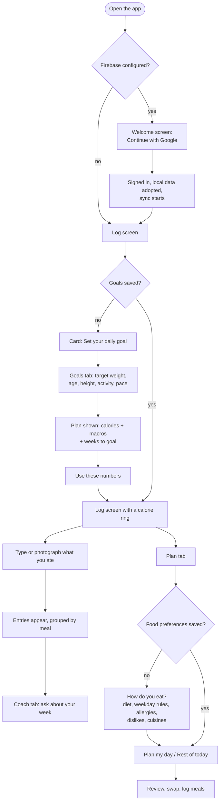

Everything works without an account. Sign-in only adds cross-device sync and server protection.

---

## 2. Logging a meal from text or a photo

The most important flow in the app.

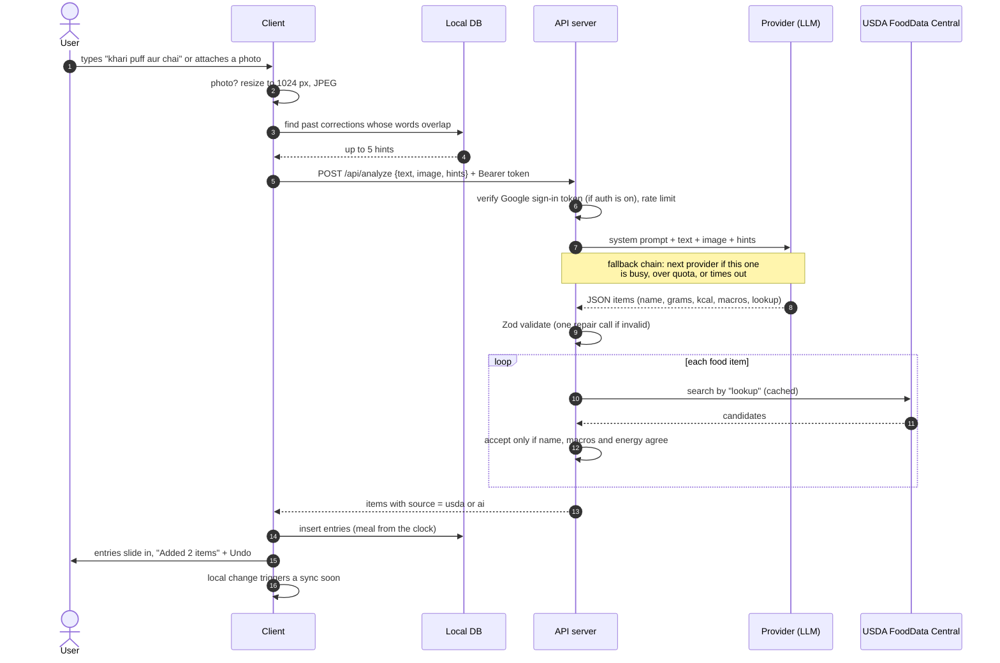

**Branches.**
- *Nothing found:* the model returns no items; the client shows its note ("not food") and adds nothing.
- *Undo:* deletes exactly the rows just created (and leaves a tombstone for sync).
- *Photos:* only a 160 px thumbnail is kept with the entry; the full image is sent once and discarded.

---

## 3. Choosing the meal from the clock

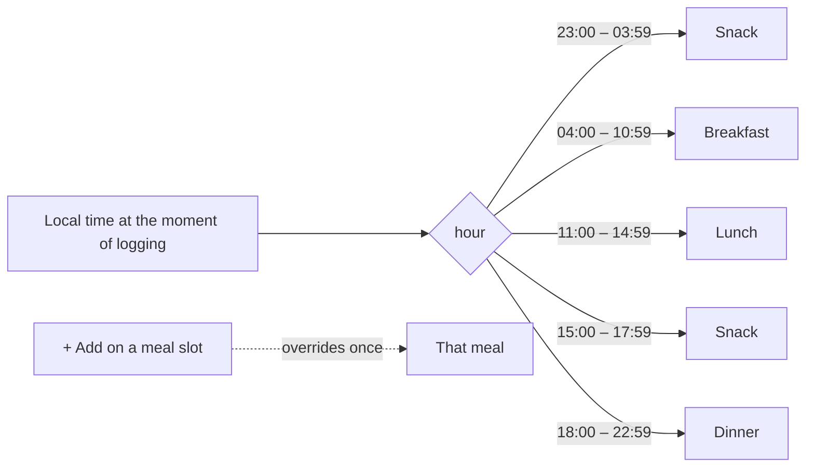

The pill beside the input always shows the current meal and time, and refreshes every 15 seconds. A meal can be changed afterwards by dragging the entry to another meal (web) or in the edit sheet.

---

## 4. Correcting an entry (how the app learns)

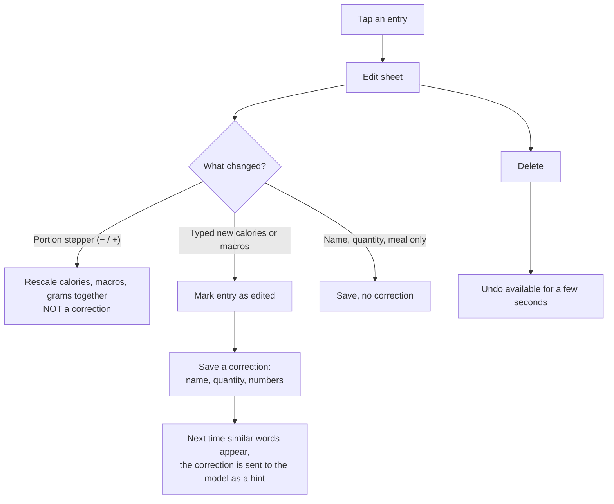

---

## 5. Everyday gestures

| Where | Gesture | Result |
| --- | --- | --- |
| Entry (phone) | Swipe **right** | Duplicate it (with undo) |
| Entry (phone) | Swipe **left** | Delete it (with undo) |
| Entry (web) | Hover, then − / + / copy / bin | Portion ±½, duplicate, delete |
| Entry | Tap | Edit sheet (phone) or dialog (web) |
| Entry (web) | Drag onto another meal | Move it (with undo) |
| Meal heading | + | Next entry goes into that meal |
| "Log again" chips | Tap | Re-add a recent food to the current meal |
| Day header | ← / → (web), tap a day in the week strip | Change day; `T` jumps to today |
| Phone | Haptic tick, press, success, error | Confirms taps, steppers, swipes and results |

Every destructive action is reversible for a few seconds.

---

## 6. Planning the day with the recommendation engine

### 6.1 What the user does

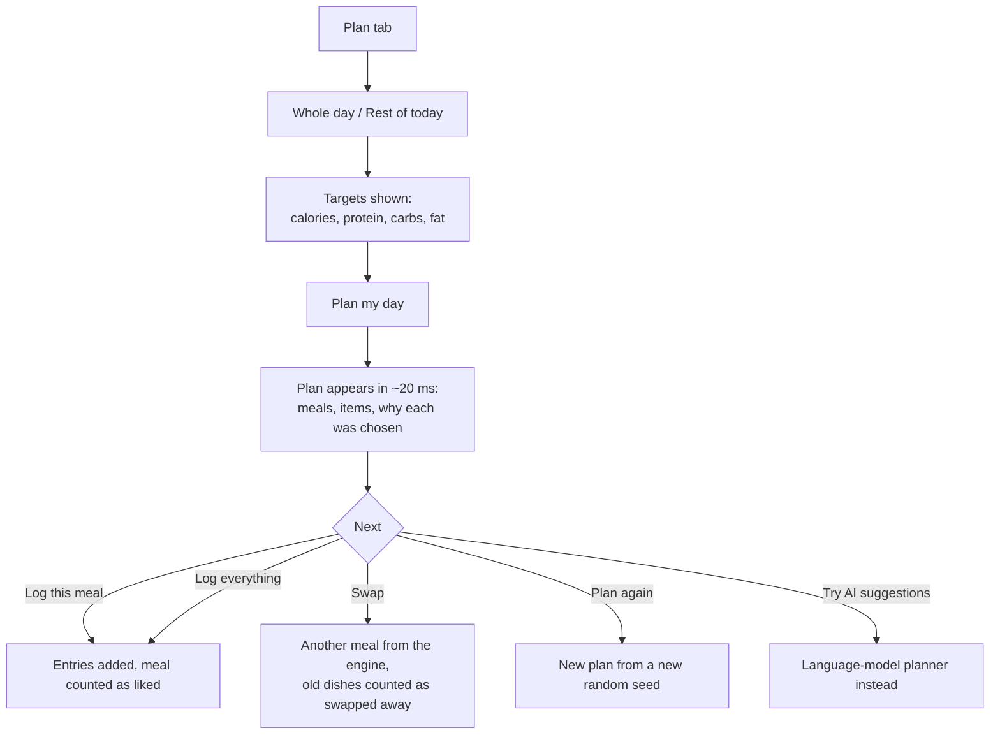

"Rest of today" subtracts what you have already eaten (and adds back calories burned), and plans only the meals that are still ahead and not yet logged.

### 6.2 What the engine does

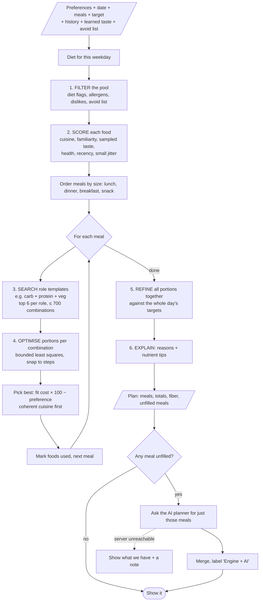

### 6.3 The learning loop

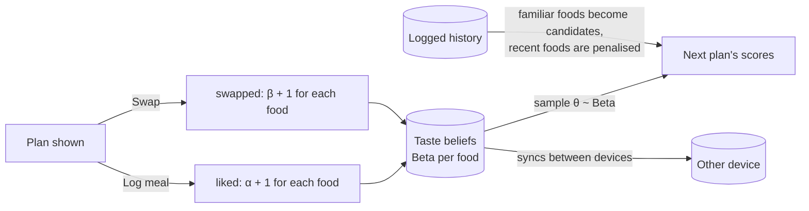

---

## 7. The coach

Your data stays on the device. The model asks for the pieces it needs, the device runs those lookups, and the answer is built from the results.

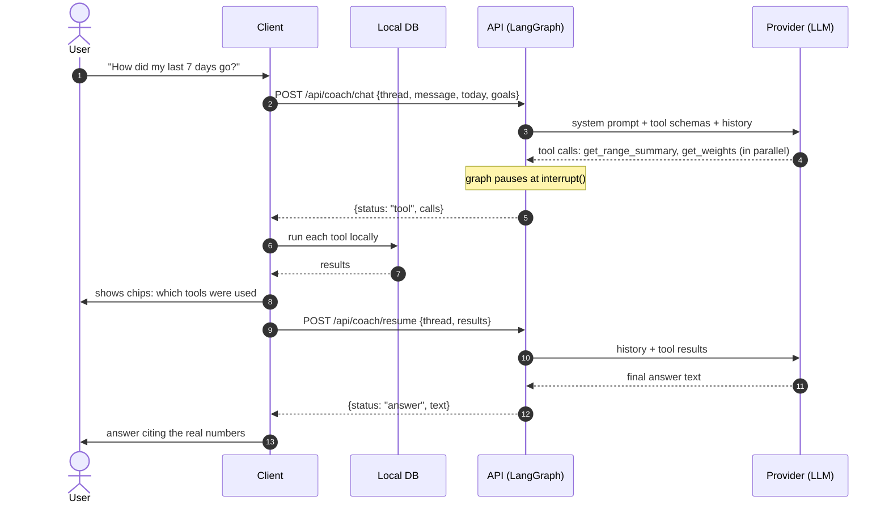

At most five model turns per question. If a request fails mid-conversation, the client starts a fresh thread (a pending tool call would otherwise block the next question; the server answers `409 thread_busy`). With `COACH_ENGINE=classic` the same idea runs through a JSON protocol on `/api/coach`.

---

## 8. Signing in and syncing

### 8.1 Lifecycle

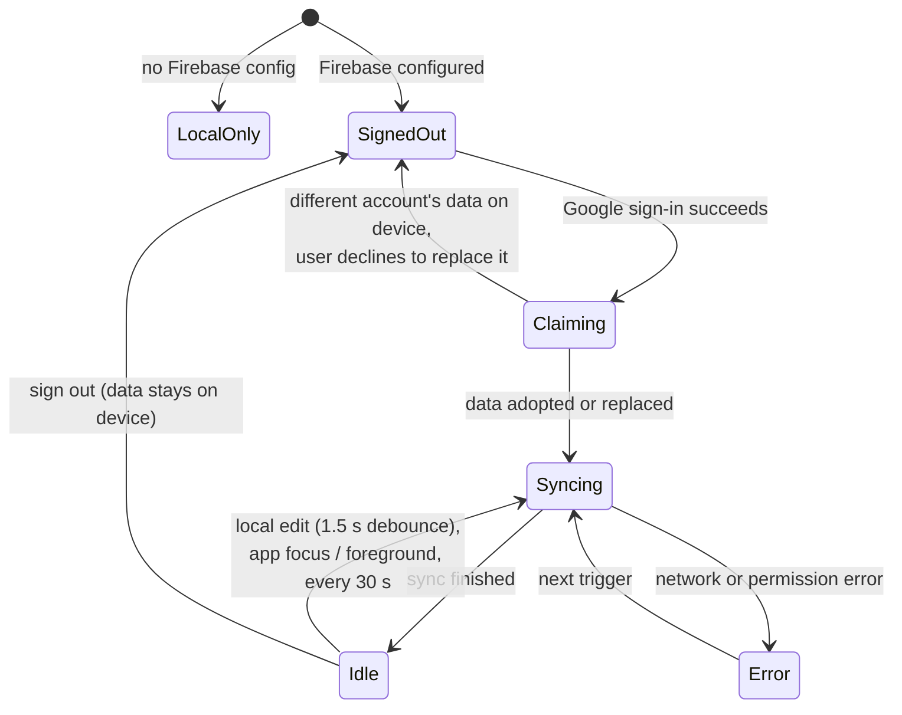

**Claiming local data.** The device remembers which account owns its data. First sign-in adopts whatever is already there (so your existing log is uploaded). Signing in with a *different* account on a device that already holds another account's data asks before replacing it; the other account's data stays safe in the cloud.

### 8.2 One sync cycle

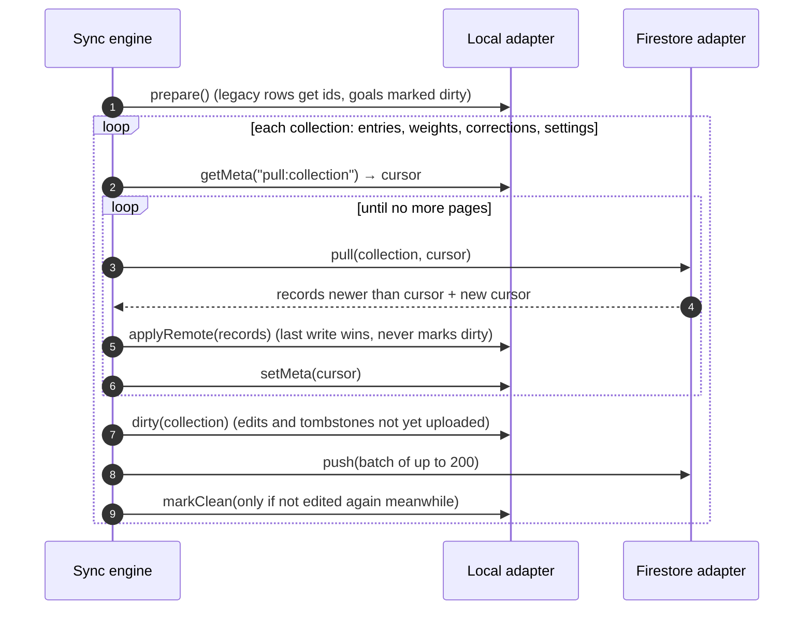

### 8.3 Conflict examples

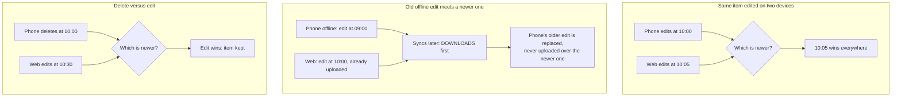

Undo after a delete re-creates the same record, which wins over its own tombstone (the tombstone is dropped before upload).

### 8.4 Offline

Nothing in the app needs the network except AI calls and sync. Offline, logging by hand-editing, planning (the engine runs locally), the calendar, the weight chart and goals all work. Edits queue as dirty rows and upload automatically when a sync next succeeds.

---

## 9. Calling the API: authentication and fallback

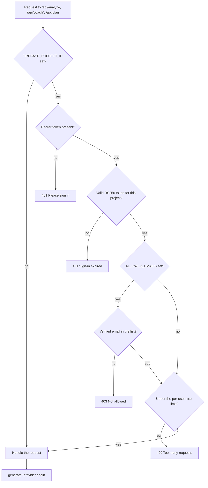

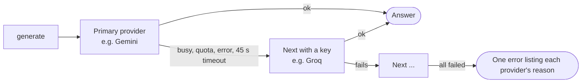

Photos switch Groq to its vision model automatically.

---

## 10. Setting goals

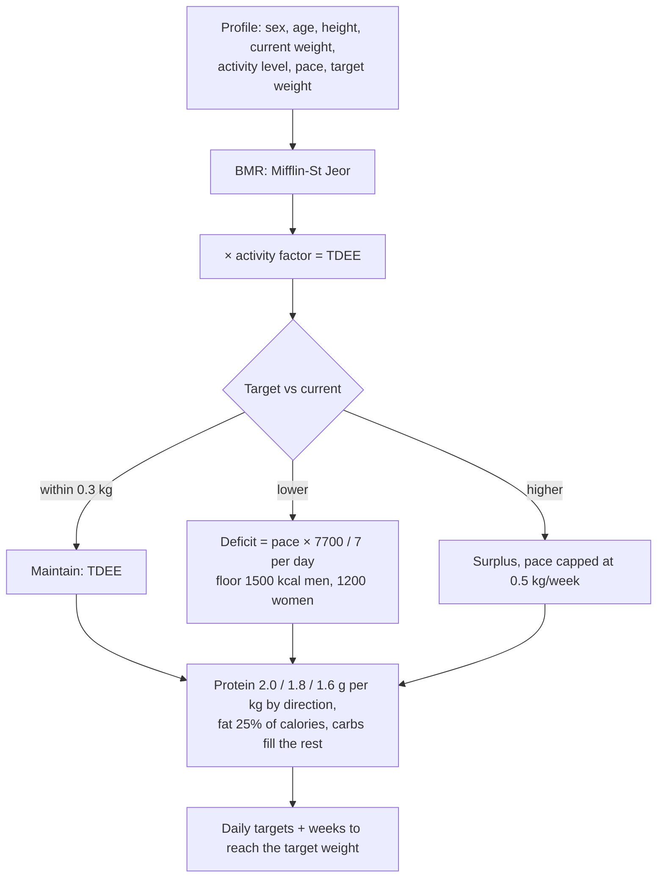

The result fills the daily targets; any number can still be edited by hand.

---

## 11. Running, building and shipping

### 11.1 Day-to-day development

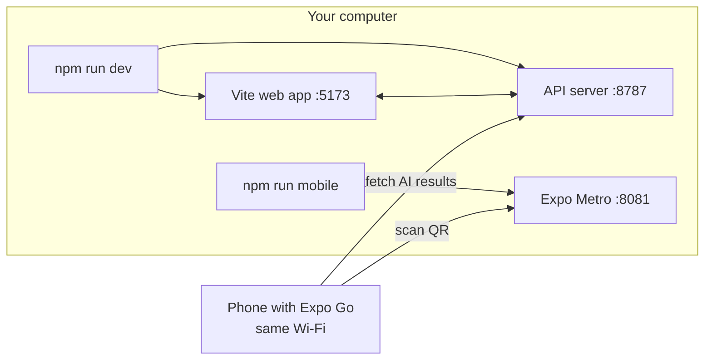

`npm run mobile` is the Expo Go flow; `npm run mobile:dev` is for a development build; `npm run mobile:clear` clears the cache; `npm run mobile:lite` limits Metro's memory (it is the heaviest process, around 500 MB).

### 11.2 Turning on Google sign-in and sync

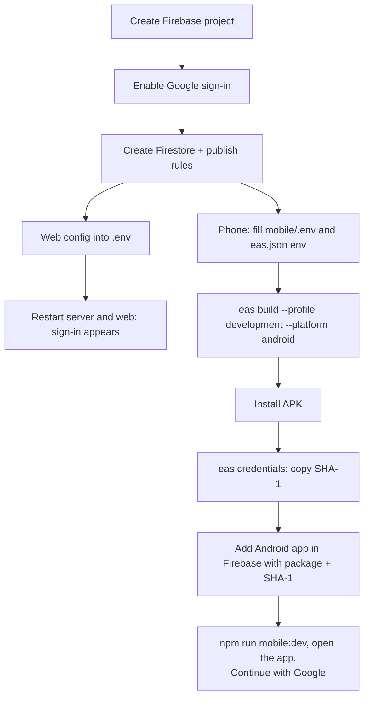

Full instructions: [SETUP-FIREBASE.md](SETUP-FIREBASE.md).

### 11.3 Verifying a change

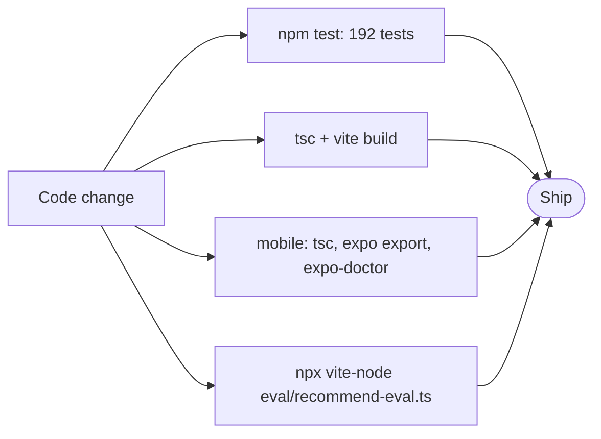

The same checks (types, tests, build) run in GitHub Actions on every push.

---

## 12. What the user sees when something goes wrong

| Situation | What happens |
| --- | --- |
| Model is busy or over quota | The next provider in the chain answers; if all fail, one clear error lists each reason. |
| A model call stalls | After 45 s it is treated as a failure (no endless spinner). |
| Model returns malformed JSON | One automatic repair attempt, then a plain error. |
| USDA lookup fails or finds nothing good | The model's estimate is used and labelled "est.". |
| Server not reachable from the phone | "Can't reach your Journable server…" with what to check; Goals → Server has a test button. |
| Not signed in / expired / not allowed / rate-limited | 401 / 401 / 403 / 429 with a plain message. |
| Firestore rules not published | Sync status shows "Missing or insufficient permissions" and points to the setup guide. |
| Different Google account on a used device | A confirmation before the device's data is replaced. |
| Google sign-in in Expo Go | A clear message that it needs the development build; nothing crashes. |
| Catalog cannot fill a meal for an unusual diet and cuisine | The AI fills just that meal, or a note says it could not. |
| Camera permission denied | A message saying how to allow it. |
| Quota exhausted during a benchmark | The run stops early and refuses to save misleading results. |
